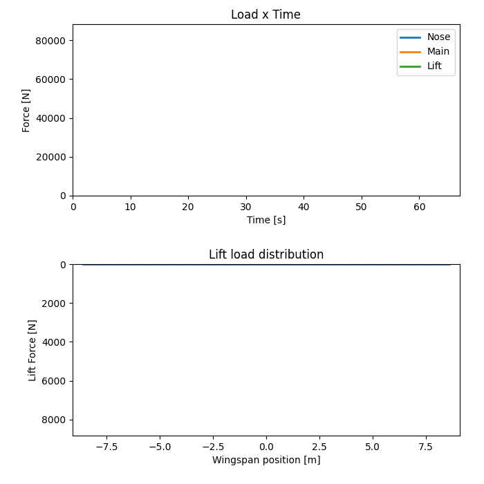

# Takeoff Loads

<p align="center">
  
</p>

A lightweight Python model for simulating simplified takeoff loads for a small aircraft. The project estimates lift, drag, and landing gear reaction forces during the takeoff phase, providing a clear visual summary of how aircraft loads evolve as speed increases.

## Overview

This repository implements a reduced-order longitudinal takeoff model based on basic aerodynamic relationships and simple structural load assumptions. It is designed for quick analysis and educational purposes, helping visualize how thrust, drag, and lift affect the aircraft during acceleration and rotation.

The simulation focuses on:

- Wing lift generation
- Tailplane lift contribution
- Drag force estimation
- Nose and main gear reaction loads
- Lift distribution across the wingspan
- Animated plotting of force evolution with speed

## Features

- Simplified aircraft takeoff simulation
- Constant mass and thrust assumptions
- Lift and drag calculations using basic aerodynamic formulas
- Nose and main landing gear reaction estimation
- Wing lift distribution profile
- Animated output for visual interpretation of the takeoff phase

## Repository Structure

```text
Takeoff_Loads/
├── main.py          # simulation and plotting logic
├── TakeOff.gif      # animation preview
├── README.md        # project documentation
├── .gitignore       # repository ignore rules
└── TakeOff_lift.mp4 # generated animation output (if produced locally)
```

## Requirements

The project uses the following Python packages:

- Python 3.9+
- NumPy
- Matplotlib

Install dependencies with:

```bash
python -m pip install numpy matplotlib
```

## Running the Simulation

From the repository root, execute:

```bash
python main.py
```

This script computes the takeoff load behavior and generates a plot animation. The default output is saved as:

```text
TakeOff_lift.mp4
```

## Model Assumptions

This is a simplified engineering model and intentionally uses idealized assumptions, including:

- Constant aircraft mass and thrust
- Uniform air density during the takeoff phase
- Fixed aerodynamic coefficients for lift and drag
- Longitudinal motion only
- Simplified reaction-force calculations for landing gear

## Outputs

The simulation provides a visual interpretation of:

- Nose gear reaction force vs. speed
- Main gear reaction force vs. speed
- Total wing lift vs. speed
- Lift distribution along the wingspan

## Intended Use

This repository is intended for:

- Learning about simplified aircraft takeoff dynamics
- Educational demonstrations of aerodynamic forces
- Quick conceptual analysis of load evolution during takeoff

It is not a substitute for detailed aircraft performance analysis or certified flight dynamics tools.

## Example Visualization

The repository includes a motion preview of the simulation below:

<p align="center">
  
</p>

## Author

Kaique Fernandes

## License

This project does not currently declare a license. If you plan to share or distribute it publicly, consider adding an open-source license such as MIT or Apache 2.0.
